  

  

&nbsp;&nbsp;
&nbsp;&nbsp;
&nbsp;&nbsp;
&nbsp;&nbsp;

Full stack developer and B.Tech CSE student at **Medi-Caps University, Indore** (2023–2027).

I ship real projects with **React**, practice **Data Structures and Algorithms in Java**, and I'm going deep on **Java Spring Boot** backends. I build in public and share what I learn along the way.

- 🚀 Built **Habitfy** (productivity SaaS) and **SAKHA** (AI voice assistant)
- ☕ Learning **Spring Boot REST APIs, Spring Data JPA, Spring Security + JWT, PostgreSQL, Redis, Docker and AWS**
- 🎤 Public speaker at NSS Technical Dept., Medi-Caps University (2024–25)
- 📍 Based in Indore, India

  

<h3 align="center">Backend</h3>

<h3 align="center">Frontend</h3>

<h3 align="center">Databases and Auth</h3>

<h3 align="center">DevOps and Cloud</h3>

<h3 align="center">Tools</h3>

### Portfolio

My personal developer portfolio showing my projects, skills and journey. It works as my online resume.

  

---

&nbsp;&nbsp;

 

### &nbsp;&nbsp;&nbsp;SAKHA

&nbsp;&nbsp;&nbsp;An AI voice assistant with chat and voice mode, live web search, Google Calendar sync and memory.

&nbsp;&nbsp;&nbsp;  

---

&nbsp;&nbsp;&nbsp;&nbsp;&nbsp;

 

### Habitfy

A productivity SaaS app to build habits and keep streaks, with a finance tracker and a task manager.

   

---

&nbsp;&nbsp;

 

<table>
<tr>
<td align="center" valign="top">

</td>
<td align="center" valign="top">

</td>
</tr>
<tr>
<td align="center" valign="top" colspan="2">

</td>
</tr>
<tr>
<td align="center" valign="top" colspan="2">

</td>
</tr>
</table>

- 🥇 **NPTEL Elite, Python for Data Science** · IIT Madras · SWAYAM · [View Certificate](https://drive.google.com/file/d/1v_y5rClABdRP9Tu7Wnm4DI5rHnifdRsj/view?usp=sharing)
- ☁️ **AWS Academy Graduate, Cloud Foundations** (2026) · [View Certificate](https://drive.google.com/file/d/1x4aitx6nhbL7n8a9prRR7m7kp0QsC_bJ/view?usp=sharing)
- 🧮 **Advanced Data Structures & Algorithms** · Board Infinity · [View Certificate](https://drive.google.com/file/d/11Aee0da71_XXYyi7AT5n7a6kKitBaQOJ/view?usp=sharing)
- 🤖 **Generative AI Studio** · Google Cloud · Simplilearn · [View Certificate](https://simpli-web.app.link/e/8pVFMNH4C2b)
- ☁️ **Google Cloud Platform** · Simplilearn · [View Certificate](https://simpli-web.app.link/e/CNmP6LP4C2b)
- 🌐 **Sigma 8.0, Full Stack Web Development** · Apna College

&nbsp;&nbsp;&nbsp;&nbsp;
&nbsp;&nbsp;&nbsp;&nbsp;

&nbsp;&nbsp;&nbsp;&nbsp;

